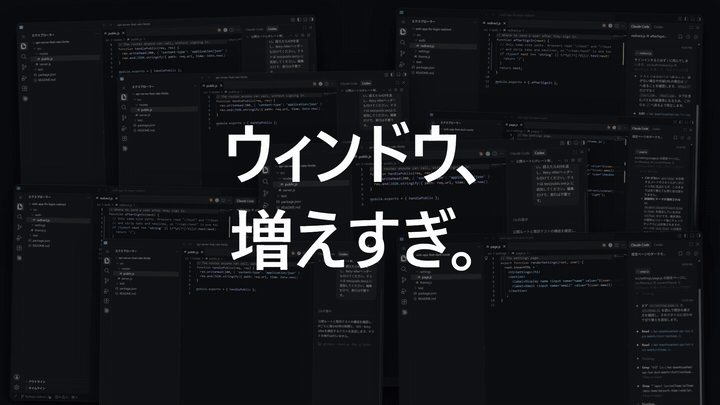
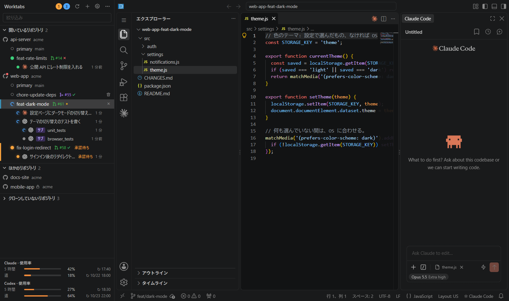

Claude Codeを並列で回すようになってから、ウィンドウを切り替える回数がえらいことになりました。

1つのVS Codeで複数のセッションを動かすとClaude同士がぶつかるのでworktreeに分けてみたら、今度はウィンドウが増えすぎて収拾がつかない状態に。どのウィンドウのClaudeが何をしていたのか、もうわからないんですよね。同じ目にあっている人もけっこういると思うんですが、私はとうとう我慢できなくなって、自分で作ってしまいました。

[Worktabs](https://github.com/worktabs/worktabs)というアプリで、WindowsとmacOSで動きます。この記事は、作るに至るまでの愚痴と、作ってみてよかったことの話です。


*画面は見本のデータです*

ちなみに私の場合、クローンしているリポジトリは数十個あるものの、普段よく触るのは7、8個で、同時に作業するのは3リポジトリくらい。動かしているセッションはだいたい3〜5本で、本気を出すときは10本までいくこともありますが、頭が死にます。

## 1つのVS Codeで並列にしたら、Claude同士がぶつかった

最初は、1つのVS Codeで複数のセッションを動かしていたんです。ところがClaudeはそれぞれ、ほかのClaudeがやった編集を知らないまま自分の作業を進めるので、コンフリクトを起こしては、その後始末に無駄な時間を使う、の繰り返し。

これを避けるためにgit worktreeを使い始めました。分離するだけならCLIの`claude --worktree`がありますし、VS Code拡張でも「work in a worktree」と頼めばやってくれます（[issueでの回答](https://github.com/anthropics/claude-code/issues/69554)）。ただ、変更をエディタで見ながら進めたいと思うと、結局worktreeごとにVS Codeを開くことになるわけで。

## worktreeに分けたら、今度はウィンドウガチャが始まった

するとどうなるかというと、ウィンドウが増えるんですね。macOSなら`window.nativeTabs`でタブにまとめられますが、Windowsにこの設定はなし。Alt+Tabを押しても、マウスで切り替えようとしても、似たような名前のウィンドウの中から目当てのやつを探すことになります。

ウィンドウガチャみたいな状況が始まります。そして、しばしば、外します。

## VS Codeを開くだけでも、毎回ひと手間

ウィンドウが増えるということはVS Codeを開く回数も増えるということで、これも地味に面倒でした。Windowsならエクスプローラーでリポジトリのフォルダまで降りていって右クリックから「Codeで開く」、WSLのリポジトリならターミナルで`cd`してから`code .`。

もちろん手をこまねいていたわけではなくて、[ghqとfzf](https://qiita.com/mfunaki/items/e1eef8d9c85dfd58a61d)でリポジトリを選んで開けるようにはしていました。それでも、開くたびにターミナルを出してコマンドを打って絞り込んで、という何かしらの作業は毎回残るわけです。大した手間ではないはずなのに、ちょっとずつストレスがたまっていくんですよね。

ちなみに[ghq](https://github.com/x-motemen/ghq)は、Worktabsを使うかどうかに関係なく入れておいたほうがいいです。神。何をしてくれるツールなのかは[こちらの記事](https://qiita.com/suin/items/52fa8bfd6e56f024cb9f)をどうぞ。

## 気づくと、Claudeが正座して待っている

そもそも作り始めたきっかけはこれでした。別のウィンドウで作業しているあいだに、隣のClaudeが承認待ちのまま止まっていることがよくあって、いつから待っていたのかもわからない。文句も言わずに正座で待っていてくれたのかと思うと、さすがに申し訳ない気持ちになります。

かといってこれを防ごうとすると、ウィンドウを1つずつ見て回るしかありません。エージェントに仕事を任せたはずなのに、気づけば自分がウィンドウの見回り係になっていたという、笑えない話です。

## 流行りのツールじゃダメだったの？

もちろん探しましたし、エージェントを並列で回すツールはいま本当に山ほどあります。ただ、有名どころを見ていっても、自分の使い方にぴったりはまるものはなかなか見つからず。

[herdr](https://github.com/herdrdev/herdr)はエージェント向けのターミナルマルチプレクサで、ターミナルで暮らしている人にはよさそうです。ただ私の場合は、エディタで選択している箇所をClaudeに渡す連携や画像の貼り付けが、VS Code拡張のようにはいかなくて、しっくりきませんでした。

[Orca](https://github.com/stablyai/orca)はworktreeごとにエージェントを並べられて、かなりいい線をいっていると思います。とはいえClaude CodeはCLIとして動かす形で、実験的なチャット欄はあるものの、VS Code拡張のチャット欄ほどの機能はなし。

Claudeのデスクトップアプリも、Codeタブでworktreeごとに会話を分けられるんですが、VS Codeのエディタと拡張は使えません。ConductorやSupersetに至ってはmacOS専用で、Windowsの私はお留守番。

このあたりのモヤモヤを言葉にしてくれたのが[T3 Code](https://t3.codes)でした。サイトには「Your agents deserve better than a terminal.」とありますし、作者のひとりのTheoさんも[動画](https://www.youtube.com/watch?v=dLhcLqoff6k)で、ターミナルをまたいで複数のセッションを行き来するつらさや、GUIなら画像も貼りやすいといった話をしていて、よくわかる！となったんですよね。画像の話はまさにherdrで引っかかったところですし、Orcaも含めて、ターミナルの延長でエージェントを動かすところが私には合わなかったんだと思います。

じゃあT3 Codeに乗り換えるかというと、私の場合は「普通のVS Codeが使いたいんじゃー」となってしまう。T3 Codeは独自のチャット画面でエージェントを動かしますが、Worktabsはそのチャット欄すら作っていないので、ここは今でもこっちのほうが強いと思っています。

どれも良いツールだとは思うんです。でも私がほしかったのはもっと地味なもので、いつものVS Codeで、いつものClaude Code拡張のまま、worktreeごとに並列にして、誰が待っているかだけ一目でわかるようにしたかった。

ないなら作るか、となりました。

## 作ったもの

やっていることは単純で、worktreeごとにVS Code（code-server）を起動して1つのウィンドウのタブにまとめ、左のサイドバーに全部の会話の状態を並べているだけです。


*左に全部の会話、右にいつものVS Code（画面は見本のデータです）*

まずVS Codeを開く話ですが、一度使ったリポジトリは左のサイドバーに並んでいるので、選べばそのまま開きます。ghqが入っていれば`ghq list`のリポジトリが最初から全部並ぶので、これがクソ便利。フォルダを探すことも`cd`することもなくなりましたし、WSLの中のリポジトリも同じように開けて、前回開いていたタブは次の起動で戻ってきます。

ウィンドウガチャのほうも、全部タブになったおかげでサイドバーのworktreeをクリックすれば切り替わるようになり、もう引かなくてよくなりました。

正座問題には、バッジと通知で対応しています。会話ごとに作業中・承認待ち・完了のバッジが出て、その状態になってからの時間もわかるようにしました。裏のタブの会話が承認待ちになったり終わったりするとOSの通知が来て、クリックすればその会話に飛べるので、見回り係は無事に廃業。

ほかにも、自分がほしくて足していった機能がいくつかあります。

- worktreeの追加と削除はサイドバーからできて、`.env`みたいなファイルは`.worktreeinclude`に書いておくとコピーされます
- GitHubのissueやPRの番号からworktreeを作れて、issueならブランチ名はClaudeが考えてくれます
- worktreeの行に、PRの状態とCIの結果が出ます
- 自分やorgのGitHubリポジトリでまだクローンしていないものも一覧に出て、ボタン1つでクローンできます
- 使っていないタブは休止して、メモリを空けます

画面は日本語と英語に対応していて、Codexも対応する拡張をインポートすれば同じように使えます。

動いているところは40秒の動画にまとめたので、雰囲気はこちらでどうぞ（音が出ます）。

https://www.youtube.com/watch?v=mR1Rff7QtwY

## このツールのお約束

Worktabsには決めごとがいくつかあって、機能を削っただけに見えるかもしれませんが、使ってみると案外こっちのほうが楽だったりします。

### その1 新しい操作は覚えなくていい

独自のエディタやチャット欄は作っていなくて、各タブはVS Code、チャット欄はClaude Code拡張そのものです。

新しいツールを入れるたびに画面の見方やショートカットを覚え直すのって、地味に疲れませんか？ Worktabsで新しく覚えるのは左のサイドバーくらいなので、入れたその日から普段どおりに使える。個人的にはこれがいちばんでかいと思っています。

チャット欄を作り直していないおかげで、拡張に新機能が来ればそのまま使えるのもありがたいところ。Claude Codeの進化に、こっちが必死でついていかなくて済んでいます。

### その2 手元の環境には手を出さない

`~/.claude/settings.json`もリポジトリの`.claude/`も変更せず、hooksが効くのはWorktabsが起動した会話だけにしています。

worktreeも普通のgit worktreeなので、`git worktree`やOrcaで作ったものもそのまま開けますし、Worktabsをやめたくなったとしても、手元には普通のworktreeが残るだけ。

### その3 勝手に走り出さない

issueからworktreeを作っても、Worktabsがやるのは新しい会話の入力欄に指示を下書きとして入れるところまで。送信するかどうかは自分で決められます。

### その4 メモリはしっかり使う

タブ1つで約0.8GB、これとは別にアプリ全体で約1GB。VS Codeをタブの数だけ起動しているので、まあそうなるよなという感じです。そのぶん、使っていないタブは休止すれば空くようにしてあります。

### その5 PCの前にいるとき専用

手元の実機で動かすためのものなので、外出中の出番はありません。私自身も、PCの前ではWorktabs、外ではClaudeのクラウドのセッションと使い分けています。

## 今どき、ループやグラフじゃないの？

ここまで読んで「今どきループエンジニアリングやグラフエンジニアリングでしょ、人間が承認待ちを見に行ってる場合？」と思った人もいるかもしれません。

[ループエンジニアリング](https://qiita.com/aktsmm/items/3408f1a6ed7a5d84bd41)は、エージェントに毎回プロンプトを打つのをやめて、計画・実行・評価を繰り返す仕組みのほうを設計する考え方で、[グラフエンジニアリング](https://qiita.com/Syoitu/items/e529a09b3d840c85c339)は、そのループを複数つないで順番や並列を設計する考え方。どちらも必要なものだと思いますし、決まった作業をぶん回すなら、こっちが正解なんだろうなとも思っています。

ただ、ちゃんとしたループには、機械で判定できる止まる条件や、実装とは別の検証の仕組みが要るんですよね。普段よく触る7、8個のリポジトリを行ったり来たりしていると、言語もテストの有無も違うそれぞれに、そこまで作り込むのがめんどくさい。「ここの挙動をちょっと変えて」くらいの作業なら、止まる条件を書いている間に終わってしまいます。

作っている途中で「やっぱりこっちにしよう」となることも多くて、そういうときは人間が会話に割り込むのが結局いちばん早い。なのでWorktabsは、人間がセッションを見て回る前提のまま、その見回りだけを楽にする方向に割り切っています。

とはいえ、Worktabsを使うとループが組めなくなるわけではありません。ループの本体である止まる条件や検証の仕組みは、テストやCI、スキルのようにリポジトリの側に作るものなので、Worktabsがあってもなくても話は同じ。そこまでやる価値があるリポジトリだけ、腰を据えて組めばいいかなと。

セッションを10本回すと頭が死ぬ人間こそループを組むべきでは、という気もしますが、それはまた別の話ということで。

## 合わないかもしれない人

ここまで書いておいてなんですが、もちろん合わない人もいると思います。ターミナルで完結させたい人にはherdrのようなツールのほうが向いていますし、複数のエージェントを1つのGUIで束ねたい人にはT3 Codeが合うはず。スマホから触りたいだけなら、Claudeユーザーは素直にClaudeアプリを使いましょう。純正アプリは神です。

それから各タブの中身はcode-serverで、デスクトップ版のVS Codeとは設定も拡張も別になります。Claude Code拡張はOpen VSXから入りますし、対応していて利用が許されている拡張はインポートもできますが、普段の環境がまるごと付いてくるわけではありません。

Codexを使いたい人には、もうひとつ弱点が。code-serverが使うOpen VSXにもCodex拡張はあるのですが、更新が46日止まっていた時期もあったので、今のWorktabsではデスクトップ版のVS Codeに入っている拡張をコピーしてくる形にしています。更新するときも、デスクトップ版で更新してから取り込み直す必要あり。ここは[Open VSXから入れられるように直す方向](https://github.com/worktabs/worktabs/issues/50)で考えています。

しかも10月の版（26.1021.22027）は、チャット欄が起動前に3,203個ものモジュールを先読みしようとして、code-serverのタブごと固まるという代物でした。今はWorktabs側で先読みを間引いてしのいでいます。

動作を確かめているのはWindows 11とmacOS（Apple Silicon）だけで、Linuxの方には申し訳ない。

## 中身の話を少しだけ

worktreeごとにcode-serverを1プロセス起動していて、どれも`127.0.0.1`だけで待ち受けています。

会話の状態はClaude Codeのhooksから取っていて、拡張が`claude`を起動するときに小さなラッパーを挟み、`--settings`でHTTP hooksを足すという形。サイドバーから会話を前に出す操作は、各タブに入れた小さな補助拡張が受け持っています。

## 使ってみる

[Releases](https://github.com/worktabs/worktabs/releases)からダウンロードできます。Windowsのインストーラーはユーザーごとのインストールなので、管理者権限は不要。

個人開発でまだ署名をしていないため、初回だけちょっとした儀式があります。WindowsはSmartScreenの警告で「詳細情報」→「実行」を押して、macOSは起動の前に次のコマンドを実行してください。

```sh
xattr -dr com.apple.quarantine /Applications/Worktabs.app
```

最初の起動でcode-serverと拡張を約300MBダウンロードします。必要なのはgitと自分のClaudeアカウントだけ。ghqがなくてもサイドバー上部の「＋」からリポジトリを足せますが、さっきも書いたとおり、入れておくのがおすすめです。

まだ早期プレビュー（v0.x）で、版が変わると設定や動きが変わることがある点だけご容赦ください。

## おわりに

身も蓋もないことを言うと、そもそもVS Code本体にWorktabsの左ペインが付いてくれれば、全部解決なんですよね。ついでにElectronをやめてRustにしてくれると、メモリの話まで片付いてとてもうれしい（そう嘆いているWorktabsもElectron製なんですが）。

それまでは、ウィンドウガチャで消耗している人や、Claudeをつい正座させてしまう人に試してもらえるとうれしいです。不具合や「ここが合わない」という話があれば、issueに日本語で書いてもらって大丈夫です。

https://github.com/worktabs/worktabs

なお、WorktabsはAnthropicやOpenAIとは関係のない個人のプロジェクトです。Claude CodeはAnthropicの商標、CodexはOpenAIの商標です。
